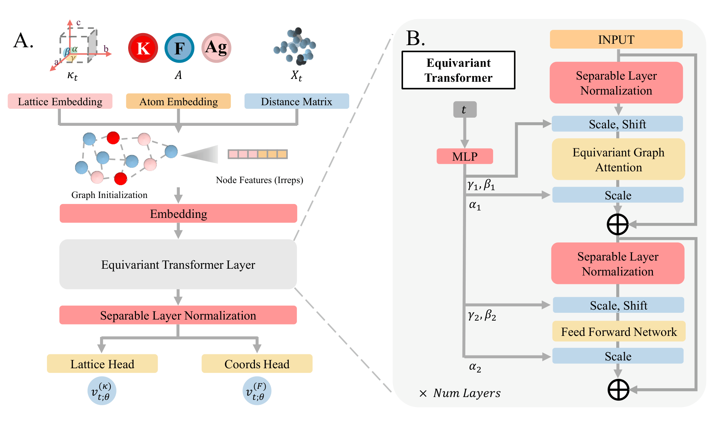

# 🔬 OPAL-CSP

**Official training and sampling code for OPAL-CSP, the crystal structure prediction model proposed in:**
> *Quantitative Assessment of Crystal Structure Prediction*
>
> Sergio Rincón\*, Gabriel González\*, Nicolás Andrade, Rafael Velásquez, Sebastián Ojeda, Juanita Puentes, Nicolás Aparicio, Paula Cárdenas, Pablo Arbeláez
>
> Universidad de Los Andes, Colombia
>
> \* Equal contribution

[](https://www.python.org/)
[](https://developer.nvidia.com/cuda-toolkit)
[](LICENSE)

---

<p align="center">
  
</p>

OPAL-CSP is an SE(3)-equivariant flow-matching model for Crystal Structure Prediction (CSP) with an EquiformerV2 backbone. Given a composition, it jointly generates the lattice, in an invariant 6-dimensional polar representation, and the fractional atomic coordinates, with a separate velocity-field head for each:

- **Lattice:** linear interpolation path. Before training, the source distribution of the fifth polar component is shifted by its training-set mean, so that all six components contribute equally to the lattice loss.
- **Fractional coordinates:** wrapped path that respects periodic boundary conditions.
- **Conditioning:** the time step conditions every layer through adaptive separable layer normalization.

This repository contains everything needed to train the four models from the paper (`perov_5`, `carbon_24`, `mp_20`, `mpts_52`) and sample the predicted structures that are evaluated with OPAL-Bench.

---

## ⬇️ Download this repository

OPAL-CSP lives in the `OPAL-CSP/` folder of the OPAL repository:

```bash
git clone https://github.com/BCV-Uniandes/OPAL.git
cd OPAL/OPAL-CSP
```

All commands in this README are run from inside `OPAL-CSP/`, and all paths (`data/`, `models/`, `results/`, `wandb/`) are relative to it.

---

## 🛠️ Prerequisites

You need **micromamba** and **git**. See the "Prerequisites" section of the [main OPAL README](../README.md) for installation instructions.

---

## 📂 Data

The train/val/test splits of the four datasets are included in `data/{dataset}/{train,val,test}.csv`. No download is needed.

| Dataset | Structures | Atoms per cell | Split (train/val/test) | Description |
| --- | --- | --- | --- | --- |
| `perov_5` | 18,928 | up to 5 | 60/20/20 | Perovskite materials |
| `carbon_24` | 10,153 | 6 to 24 | 60/20/20 | Carbon-only structures, highly polymorphic |
| `mp_20` | 45,231 | up to 20 | 60/20/20 | Inorganic crystals from the Materials Project |
| `mpts_52` | 40,476 | up to 52 | 67.6/12.4/20 | Inorganic crystals from the Materials Project |

On the first run of each dataset, the CSVs are converted to CIF files (`data/{dataset}/{split}/`) and preprocessed into cached tensors (`data/{dataset}/{split}.pt`). Later runs load the cache directly.

---

## ⚡ Quick Reproduction

```bash
# 1. Install the environment
chmod +x install_OPAL-CSP.sh
./install_OPAL-CSP.sh

# 2. Log in to Weights & Biases (or run offline, see below)
micromamba run -n OPAL-CSP wandb login

# 3. Train and sample one dataset (run from inside OPAL-CSP/)
micromamba activate OPAL-CSP
./run_opalcsp_perov5.sh
```

Each script trains for 1000 epochs, keeps the best checkpoint according to the validation loss, and then samples the test set with it. The predicted structures are written as CIF files to `OPAL-CSP/results/{ckpt_name}/` (not to the benchmark's top-level `results/` folder).

> **Hardware:** A CUDA-capable GPU with an NVIDIA driver compatible with CUDA 12.1 is required. All models train with a total batch size of 128 structures across GPUs: 4 GPUs × 32 for `mp_20` and `mpts_52`, and 2 GPUs × 64 for `perov_5` and `carbon_24`. If you use a different number of GPUs, adjust `BATCH` in the script so that `BATCH × NUM_GPUS = 128`.

> **Runtime:** Training takes about 15 hours for `perov_5` and 22 hours for `carbon_24` on 2 GPUs, and about 2 days for `mp_20` and 4 days for `mpts_52` on 4 GPUs.

---

## 📦 Installation

OPAL-CSP uses its own environment, separate from the `OPAL` environment used to evaluate structures with OPAL-Bench. Training runs in `OPAL-CSP`; evaluation runs in `OPAL`.

The environment is managed with [micromamba](https://mamba.readthedocs.io/en/latest/installation/micromamba-installation.html) and installs Python 3.11.9, PyTorch 2.3.1+cu121, PyTorch Geometric 2.5.3, Lightning 2.3.2, e3nn 0.4.4 and pymatgen, with every package pinned to the versions used to train the models in the paper.

```bash
chmod +x install_OPAL-CSP.sh
./install_OPAL-CSP.sh
```

The script will:
1. Create a micromamba environment named `OPAL-CSP`
2. Install PyTorch 2.3.1 with CUDA 12.1 support
3. Install the PyTorch Geometric CUDA extensions
4. Install all dependencies with pinned versions for reproducibility
5. Clone the OC20 repository at the commit required by [EquiformerV2](https://github.com/atomicarchitects/equiformer_v2/blob/main/docs/env_setup.md), apply its patch to `ocpmodels/common/utils.py`, and install it in editable mode inside the environment
6. Run a self-check to verify the installation

---

## 🗂️ Repository Structure

```
OPAL-CSP/
├── LICENSE                       # MIT License
├── install_OPAL-CSP.sh           # Environment installer
├── assets/                       # README figures
├── licenses/                     # License texts of third-party code
├── THIRD_PARTY_NOTICES.md        # Origin and license of third-party code and data
├── run_opalcsp_perov5.sh         # Train + sample, one script per dataset
├── run_opalcsp_carbon24.sh
├── run_opalcsp_mp20.sh
├── run_opalcsp_mpts52.sh
│
├── data/                         # Train/val/test splits
│   └── {dataset}/{train,val,test}.csv
│
└── py_files/
    ├── scripts/
    │   ├── run.py                # Entry point: training, checkpointing and sampling
    │   └── args.py               # Command-line arguments
    ├── data/                     # Dataset and Lightning DataModule
    ├── methods/flow/flow.py      # Flow matching: noise, targets and source statistics
    ├── modules/equiformer/       # EquiformerV2 backbone with AdaNorm conditioning
    └── utils/                    # Data and loss utilities
```

Generated during runs:

```
├── models/{dataset}/             # Best checkpoint ({ckpt_name}_epoch=N.ckpt) and last.ckpt
├── results/{ckpt_name}/          # Sampled structures, one CIF per test composition
└── wandb/                        # Local W&B logs
```

**Datasets:** `perov_5`, `carbon_24`, `mp_20`, `mpts_52`

---

## 🔧 Full Usage Guide

### Hyperparameters

All four models share the same training setup: 1000 epochs, Adam with lr 1e-3, `ReduceLROnPlateau` (factor 0.6, patience 30), a total batch size of 128, `max_neighbors` 20, periodic boundary conditions and seed 42. The flow-matching loss weights the fractional coordinates with `--alpha 10` and the lattice with `--beta 1`. Only the following arguments change between datasets:

| Argument | `perov_5` | `carbon_24` | `mp_20` | `mpts_52` |
| --- | --- | --- | --- | --- |
| `--batch_size` (per GPU) | 64 | 64 | 32 | 32 |
| `--num_layers` | 3 | 6 | 6 | 6 |
| `--max_radius` (Å) | 10 | 5.0 | 12 | 12 |
| `--use_frac_coords` | no | no | yes | no |
| `--num_gpus` | 2 | 2 | 4 | 4 |
| `--scheduler_monitor` | `val_joint_loss` | `val_normalized_loss` | `val_normalized_loss` | `val_normalized_loss` |
| `--ckpt_monitor` | `val_unweighted_loss` | `val_normalized_loss` | `val_normalized_loss` | `val_normalized_loss` |

These values are already set in each `run_opalcsp_{dataset}.sh` script.

The EquiformerV2 backbone uses the same architecture hyperparameters for all datasets (defaults in `py_files/modules/equiformer/equiformer_v2_cell_adanorm.py`):

| Hyperparameter | Value |
| --- | --- |
| Max degree ℓ<sub>max</sub> | 6 |
| Sphere channels | 128 |
| Attention heads | 8 |
| Attention hidden channels | 64 |
| FFN hidden channels | 128 |
| Gaussian RBF basis | 600 |
| Time embedding dim | 128 |
| Lattice embedding dim | 128 |

---

### Inference

After training, each script samples one structure per test composition by integrating the learned ODE from t = 0 to t = 1 with an Euler solver of 1000 steps. At each step, the predicted coordinate velocity is scaled by the annealing factor γ(t) = 1 + 5 ReLU(t), which progressively amplifies coordinate updates as t → 1. Sampling uses the best checkpoint of the run, or the one given with `--best_ckpt` when running with `--just_sample`.

---

### Selecting GPUs

Edit `GPUS` at the top of the script to choose which devices to use (passed to `CUDA_VISIBLE_DEVICES`):

```bash
GPUS="0,1"
```

---

### Passing extra arguments

Any argument given to a script is forwarded to `run.py` and overrides the value set in the script:

```bash
# Resume an interrupted training run
./run_opalcsp_mp20.sh --resume_ckpt models/mp_20/last.ckpt

# Sample only, from a given checkpoint
./run_opalcsp_mp20.sh --just_sample --best_ckpt models/mp_20/opalcsp_mp20_epoch=841.ckpt

# Log to your own W&B entity, or run without W&B
./run_opalcsp_perov5.sh --wandb_entity <your-entity>
./run_opalcsp_perov5.sh --wandb_mode offline
```

Run `python py_files/scripts/run.py --help` for the full list of arguments.

---

### Evaluating with OPAL-Bench

The sampled structures in `results/{ckpt_name}/` are the predictions evaluated in the paper. To evaluate them with OPAL-Bench, copy them to the benchmark's `pred_files` folder one level up:

```bash
cp results/opalcsp_perov5/*.cif ../pred_files/OPAL-CSP/Cifs/perov_5/
```

> ⚠️ If you downloaded the OSF data, `../pred_files/OPAL-CSP/` already contains the paper's predictions, and this command overwrites them. Back them up first if you want to keep them.

Then, from the repository root (`cd ..`) with the `OPAL` environment active, follow the "Full Usage Guide" in the [main README](../README.md) with `--method_name OPAL-CSP`: Step 1 (filter invalid structures), the SE(3) alignment preprocessing, Step 2 (compute metrics), and Steps 3–5. OPAL-CSP is already listed as a CSP method in the benchmark scripts, so no code changes are needed. The precomputed intersection sets in `results/intersections/` were computed with the paper's predictions; delete `results/intersections/{dataset}.json` if you want them recomputed for your new predictions.

---

### Expected results

Median OPAL-Bench scores of OPAL-CSP across test compositions in the CSP track (Table 1 of the paper). Lower is better for every metric.

| Dataset | Chamfer | Hausdorff | Sinkhorn | RMSE | ρ (g/cm³) | SOAP | XRD | FE (eV/at.) | Relaxed FE (eV/at.) |
| --- | --- | --- | --- | --- | --- | --- | --- | --- | --- |
| Perov-5 | 1.211 | 0.617 | 0.909 | 0.607 | 0.285 | 6.25 | 2.595 | 0.072 | 1.348 · 10⁻¹ |
| Carbon-24\* | 1.561 | 1.281 | 12.563 | 0.889 | 0.001 | 5.67 | 2.304 | 0.002 | 5.700 · 10⁻⁵ |
| MP-20 | 3.700 | 2.668 | 6.952 | 2.084 | 0.214 | 2.57 | 2.293 | 0.028 | 1.490 · 10⁻⁴ |
| MPTS-52 | 4.325 | 3.698 | 20.908 | 2.642 | 0.183 | 3.47 | 2.523 | 0.113 | 7.748 · 10⁻² |

\* Carbon-24 results may vary between runs due to the high uncertainty of this dataset: the high structural variance of carbon polymorphs produces wide 95% bootstrap confidence intervals on every metric (Appendix C.2 of the paper).

> **Note on reproducibility:** Retraining reproduces the code and configuration of the paper, not the weights bit for bit: multi-GPU training and stochastic sampling introduce small variations. The epoch of the best checkpoint may differ from the original run, so compare the evaluation metrics rather than the epoch.

---

## 📄 Citation

If you use OPAL-CSP in your work, please cite:

```bibtex
@inproceedings{opal2026,
  title     = {Quantitative Assessment of Crystal Structure Prediction},
  author    = {Rinc{\'o}n, Sergio and Gonz{\'a}lez, Gabriel and Andrade, Nicol{\'a}s and Vel{\'a}squez, Rafael and Ojeda, Sebasti{\'a}n and Puentes, Juanita and Aparicio, Nicol{\'a}s and C{\'a}rdenas, Paula and Arbel{\'a}ez, Pablo},
  booktitle = {Advances in Neural Information Processing Systems},
  note      = {Track on Evaluations and Datasets},
  year      = {2026},
}
```

---

## ⚖️ License

OPAL-CSP is released under the [MIT License](LICENSE).

This repository also includes code adapted from [EquiformerV2](https://github.com/atomicarchitects/equiformer_v2), the [Open Catalyst Project](https://github.com/FAIR-Chem/fairchem), [e3nn](https://github.com/e3nn/e3nn), [CrystalFlow](https://github.com/ixsluo/CrystalFlow), [DiffCSP](https://github.com/jiaor17/DiffCSP) and [CDVAE](https://github.com/txie-93/cdvae), all under the MIT license. See [THIRD_PARTY_NOTICES.md](THIRD_PARTY_NOTICES.md) for which files come from each project, and [`licenses/`](licenses/) for their license texts.

The dataset splits in `data/` come from the DiffCSP and CDVAE repositories. The underlying Carbon-24, MP-20 and MPTS-52 structures are distributed under CC BY 4.0; please cite the original sources listed in [THIRD_PARTY_NOTICES.md](THIRD_PARTY_NOTICES.md#data) when using them.

---

## 🤝 Acknowledgements

This code builds on [EquiformerV2](https://github.com/atomicarchitects/equiformer_v2), the [Open Catalyst Project](https://github.com/FAIR-Chem/fairchem), [CrystalFlow](https://github.com/ixsluo/CrystalFlow), [DiffCSP](https://github.com/jiaor17/DiffCSP), [CDVAE](https://github.com/txie-93/cdvae), [PyTorch Geometric](https://pyg.org/), [PyTorch Lightning](https://lightning.ai/), [e3nn](https://e3nn.org/), [pymatgen](https://pymatgen.org/) and [PyXtal](https://github.com/MaterSim/PyXtal).
