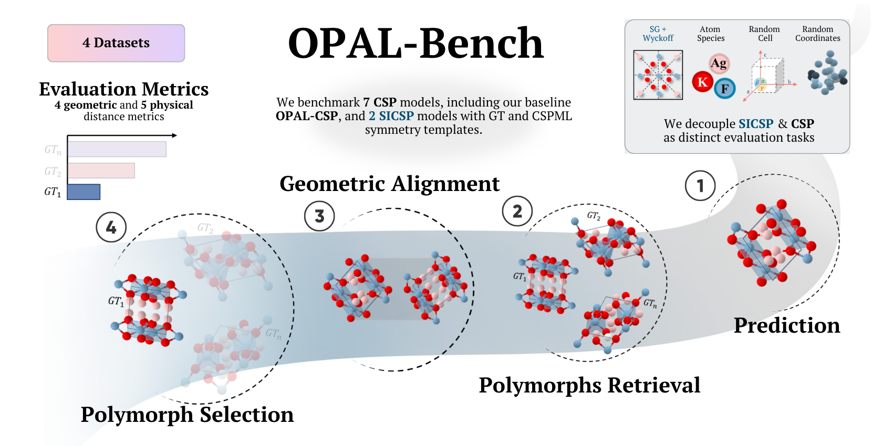

# 🔬 OPAL-Bench

**Official reproduction code for:**
> *Quantitative Assessment of Crystal Structure Prediction*
>
> Sergio Rincón\*, Gabriel González\*, Nicolás Andrade, Rafael Velasquez, Sebastian Ojeda, Juanita Puentes, Nicolás Aparicio, Paula Cárdenas, Pablo Arbelaez
>
> Universidad de Los Andes, Colombia
>
> \* Equal contribution

[](https://www.python.org/)
[](https://developer.nvidia.com/cuda-toolkit)
[](LICENSE)

---



OPAL-Bench (**O**rientation-invariant **P**olymorph-**A**ware **L**arge Benchmark) is a comprehensive evaluation framework for Crystal Structure Prediction (CSP). It addresses four limitations of prior benchmarks: applying tolerance-free metrics, explicit SE(3) alignment with atom-identity constraints, polymorph-aware evaluation, and separation of CSP and SICSP tracks.

---

## 🧪 OPAL-CSP: our CSP model

Alongside the benchmark, the paper proposes **OPAL-CSP**, an SE(3)-equivariant flow-matching model for Crystal Structure Prediction with an EquiformerV2 backbone. Its predictions are included in this benchmark under `pred_files/OPAL-CSP/`.

👉 **Training and sampling code: [`OPAL-CSP/`](OPAL-CSP/)** (see its [README](OPAL-CSP/README.md)). It uses its own micromamba environment (`OPAL-CSP`, PyTorch 2.3.1 + CUDA 12.1), separate from the `OPAL` evaluation environment described below.

---

## ⬇️ Download this repository

```bash
git clone https://github.com/BCV-Uniandes/OPAL.git
cd OPAL
```

---

## 📂 Data

The CIF structure files (~2 GB total) are hosted on OSF and must be downloaded separately:

```bash
wget -q --show-progress -O gt_files.zip   "https://osf.io/download/69fc24eea9446219fb8b917c/"
wget -q --show-progress -O poly_files.zip "https://osf.io/download/69fc251ff5868f5ed5d7510a/"
wget -q --show-progress -O results.zip    "https://osf.io/download/69fc252815bc3bbfe3f2025e/"
wget -q --show-progress -O pred_files.zip "https://osf.io/download/69fc254e4c6e95dc34f20389/"
unzip -q gt_files.zip && unzip -q poly_files.zip && unzip -q results.zip && unzip -q pred_files.zip
rm gt_files.zip poly_files.zip results.zip pred_files.zip
```

Or browse and download manually at: https://osf.io/9jhm4/

---

## 🛠️ Prerequisites

Before running the installation script, you need **micromamba** and **git**.

**Install micromamba** (if not already installed):
```bash
"${SHELL}" <(curl -L micro.mamba.pm/install.sh)
```
After installation, **open a new terminal** (or run `source ~/.bashrc`) so that `micromamba` is on your PATH before proceeding.

> See the [official micromamba installation guide](https://mamba.readthedocs.io/en/latest/installation/micromamba-installation.html) for other platforms or installation options.

---

## ⚡ Quick Reproduction

Reproduce all results from the paper in four commands:

```bash
# 1. Download the data (see Data section above)

# 2. Install the environment
chmod +x install_OPAL.sh
./install_OPAL.sh

# 3. (Required for energy metrics) Request access and log in to HuggingFace
#    First, request access to the UMA model at https://huggingface.co/facebook/UMA
#    Then authenticate:
micromamba run -n OPAL hf auth login

# 4. Run the full pipeline
micromamba activate OPAL
python reproduce.py
```

Results are saved to `results/main_results/medians.json` and `results/main_results/confidence_intervals.json`, and printed to stdout at the end.

> **Hardware:** Validated on 2× Quadro RTX 8000, CUDA 12.4, Ubuntu 22.04. A CUDA-capable GPU is required for energy metrics (MLIPs) and for recomputing the SE(3) alignment (`preprocess.py`). Geometric metrics (using the precomputed alignments) and the remaining physical metrics (density, SOAP, XRD) run on CPU.

> **Runtime:** Reproducing all results across 4 datasets and 11 methods takes **several days** of compute. The most expensive steps are:
> - **Energy metrics** (`energies`): require GPU-accelerated MLIP inference (ORB, MACE, UMA) plus structure relaxation — by far the dominant cost.
> - **SOAP distance**: runs per-structure DScribe computations in isolated subprocesses; slow on large datasets like `mpts_52`.
> - **XRD distance**: moderate cost, scales with dataset size.
>
> If you only need the geometric metrics (Chamfer, Hausdorff, Sinkhorn, RMSE) and density, you can edit `METRICS` in `reproduce.py` to skip the heavier metrics and complete the run in a few hours.

---

## 📦 Installation

The environment is managed with [micromamba](https://mamba.readthedocs.io/en/latest/installation/micromamba-installation.html) and installs Python 3.11, PyTorch 2.6.0+cu124, and 185+ packages including `pymatgen`, `dscribe`, `mace-torch`, `fairchem-core`, and `orb-models`.

```bash
chmod +x install_OPAL.sh
./install_OPAL.sh
```

The script will:
1. Create a micromamba environment named `OPAL`
2. Install PyTorch 2.6.0 with CUDA 12.4 support
3. Install all dependencies with pinned versions for reproducibility
4. Apply compatibility patches for `fairchem-core` and `lemat-genbench`
5. Run a self-check to verify the installation

> ⚠️ **Energy metrics** (formation energy and relaxed formation energy) use UMA/MACE/ORB models via HuggingFace. Two one-time steps are required:
> 1. Request access to the UMA model at https://huggingface.co/facebook/UMA (approval may take some time).
> 2. Authenticate with HuggingFace:
> ```bash
> micromamba run -n OPAL hf auth login
> ```

---

## 🗂️ Repository Structure

```
OPAL/
├── install_OPAL.sh               # Environment installer
├── reproduce.py                  # Full pipeline orchestrator
├── preprocess.py                 # SE(3) alignment preprocessing
├── filter_invalid_structures.py  # Validity filtering
├── get_csp_metrics.py            # Metric computation engine
├── filter_intersection.py        # Polymorph intersection filtering
├── get_main_results.py           # Median computation
├── compute_confidence_intervals.py  # Bootstrap CIs (95%, 10k iterations)
├── args.py                       # Shared argument parser
│
├── common/
│   ├── alignment.py              # Hungarian SE(3) alignment
│   ├── utils.py                  # Structure I/O and alignment helpers
│   └── energy_utils.py           # Multi-MLIP energy preprocessor
│
├── metrics/                      # Individual metric implementations
│   ├── chamfer.py, hausdorff.py, sinkhorn.py, superpose_rmsd.py
│   ├── density.py, soap_dist.py, xrd_dist.py
│   └── energy_mlips_dist.py
│
├── gt_files/                     # Ground truth CIF structures
│   └── {dataset}/
├── pred_files/                   # Predicted CIF structures
│   └── {method}/Cifs/{dataset}/
├── poly_files/                   # Polymorph group definitions (JSON)
├── results/
│   ├── alignment/                # Precomputed SE(3) alignments
│   ├── metrics/                  # Per-method metric values (filtered)
│   ├── intersections/            # Precomputed intersection sets
│   └── main_results/             # Medians and confidence intervals
│
├── OPAL-CSP/                     # Training and sampling code for OPAL-CSP (own README and environment)
├── assets/                       # README figures
├── licenses/                     # License texts of third-party code
├── THIRD_PARTY_NOTICES.md        # Origin and license of third-party code, models and data
└── LICENSE
```

**Datasets:** `perov_5`, `carbon_24`, `mp_20`, `mpts_52`

**Methods evaluated:**
| Track | Methods |
|-------|---------|
| CSP | CDVAE, CrystalFlow, DiffCSP, FlowLLM, FlowMM, MatterGen, OPAL-CSP |
| SICSP | DiffCSP++GT, DiffCSP++CSPML, SGEquiDiff-GT, SGEquiDiff-CSPML |

**Metrics:**
| Category | Metrics |
|----------|---------|
| Geometric | Chamfer, Hausdorff, Sinkhorn, RMSE |
| Physical | Density, SOAP distance, XRD distance, Formation energy, Relaxed formation energy |

The energy step also outputs E above hull and its relaxed variant. As distances between prediction and reference they are identical to the formation energy distances, so the paper reports only the formation energy ones.

---

## 🔧 Full Usage Guide

### Pipeline overview

The evaluation pipeline has five steps. All precomputed intermediate results (alignment, intersection sets) are included in the OSF data release so that individual steps can be run independently.

```
pred_files/ + gt_files/
        │
        ▼
[Step 1] filter_invalid_structures.py   — remove degenerate CIFs
        │
        ▼
[Preprocessing] preprocess.py           — SE(3) alignment (precomputed)
        │
        ▼
[Step 2] get_csp_metrics.py             — compute per-polymorph distances
        │
        ▼
[Step 3] filter_intersection.py         — keep only compositions valid across all methods
        │
        ▼
[Step 4] get_main_results.py            — compute medians
        │
        ▼
[Step 5] compute_confidence_intervals.py — bootstrap 95% CIs (10,000 iterations)
```

---

### Step 1 — Filter invalid structures

Removes CIF files with parsing errors, degenerate lattices, or NaN coordinates:

```bash
python filter_invalid_structures.py --dataset perov_5 --method DiffCSP --pred_only --move
```

---

### Preprocessing — SE(3) Alignment

Each predicted structure is aligned to all ground-truth polymorphs of the same composition using the Hungarian algorithm. This is **already precomputed** in `results/alignment/`. Recomputing it requires a CUDA-capable GPU, since the alignment optimization runs on `cuda`. To recompute for a specific method and dataset:

```bash
python preprocess.py \
    --pred_path pred_files \
    --gt_path gt_files \
    --dataset_name perov_5 \
    --method_name DiffCSP \
    --seed 42
```

> **Note on reproducibility:** The alignment selects one predicted structure per composition using `random.choice` seeded by `--seed`. The rotation/translation optimization may vary slightly across seeds, but aggregate median statistics are stable. The precomputed alignments use `--seed 42`.

**LCM supercell expansion** is used for SICSP methods to handle cell-size mismatches between prediction and ground truth:

```bash
python preprocess.py \
    --pred_path pred_files \
    --gt_path gt_files \
    --dataset_name mp_20 \
    --method_name DiffCSP++GT \
    --use_lcm --max_lcm 1360 \
    --seed 42
```

---

### Step 2 — Compute metrics

Run a single metric for one method and dataset:

```bash
python get_csp_metrics.py \
    --pred_path pred_files \
    --gt_path gt_files \
    --dataset_name perov_5 \
    --method_name DiffCSP \
    --metric chamfer
```

Available values for `--metric`: `chamfer`, `sinkhorn`, `hausdorff`, `superpose_rmsd`, `density`, `soap_dist`, `xrd_dist`, `energies` (computes all four energy metrics at once).

Output is saved to `results/metrics/{metric}_{dataset}_{method}.json`.

---

### Step 3 — Filter by intersection

Restricts each method's metric file to the set of compositions where **all methods in the same track** produced valid predictions, ensuring fair comparison:

```bash
python filter_intersection.py
```

Intersection sets are precomputed in `results/intersections/{dataset}.json`. If those files exist, they are used directly without recomputation.

> ⚠️ This step **overwrites** the metric files in `results/metrics/`. The unfiltered originals are not preserved automatically — back them up if needed.

---

### Step 4 — Compute medians

```bash
python get_main_results.py
```

Outputs `results/main_results/medians.json`.

---

### Step 5 — Confidence intervals

```bash
python compute_confidence_intervals.py
```

Bootstrap resampling with 10,000 iterations and seed 42. Outputs `results/main_results/confidence_intervals.json`.

---

### ➕ Adding a new method

1. Place the predicted CIF files at `pred_files/{method_name}/Cifs/{dataset}/`
2. Run the alignment:
   ```bash
   python preprocess.py --pred_path pred_files --gt_path gt_files \
       --dataset_name {dataset} --method_name {method_name} --seed 42
   ```
3. Compute all metrics:
   ```bash
   for metric in chamfer sinkhorn hausdorff superpose_rmsd density soap_dist xrd_dist energies; do
       python get_csp_metrics.py --pred_path pred_files --gt_path gt_files \
           --dataset_name {dataset} --method_name {method_name} --metric $metric
   done
   ```
4. Add the method name to `CSP_METHODS` or `SICSP_METHODS` in `filter_intersection.py`, `get_main_results.py`, and `compute_confidence_intervals.py`.
5. Delete the precomputed intersection file for the affected dataset (`results/intersections/{dataset}.json`) so it gets recomputed to include the new method.
6. Run Steps 3–5.

---

## 📄 Citation

If you use OPAL-Bench in your work, please cite:

```bibtex
@inproceedings{opal2026,
  title     = {Quantitative Assessment of Crystal Structure Prediction},
  author    = {Rinc{\'o}n, Sergio and Gonz{\'a}lez, Gabriel and Andrade, Nicol{\'a}s and Velasquez, Rafael and Ojeda, Sebastian and Puentes, Juanita and Aparicio, Nicol{\'a}s and C{\'a}rdenas, Paula and Arbelaez, Pablo},
  booktitle = {Advances in Neural Information Processing Systems},
  note      = {Track on Evaluations and Datasets},
  year      = {2026},
}
```

---

## ⚖️ License

OPAL-Bench is released under the [MIT License](LICENSE).

This repository also includes code adapted from [PyTorch3D](https://github.com/facebookresearch/pytorch3d) (BSD-3-Clause) and [point-cloud-utils](https://github.com/fwilliams/point-cloud-utils) (MIT). See [THIRD_PARTY_NOTICES.md](THIRD_PARTY_NOTICES.md) for which files come from each project, and [`licenses/`](licenses/) for their license texts. OPAL-CSP lists its own third-party code in [OPAL-CSP/THIRD_PARTY_NOTICES.md](OPAL-CSP/THIRD_PARTY_NOTICES.md).

The structures in the OSF data release are derived from Perov-5, Carbon-24, MP-20 and MPTS-52. Carbon-24, MP-20 and MPTS-52 are distributed under CC BY 4.0; please cite the original sources listed in [THIRD_PARTY_NOTICES.md](THIRD_PARTY_NOTICES.md#data) when using them. The MLIP weights used for energy metrics (ORB, MACE, UMA) are downloaded at run time and are subject to their own licenses; UMA requires accepting its license on Hugging Face.

---

## 🤝 Acknowledgements

This benchmark builds on [pymatgen](https://pymatgen.org/), [DScribe](https://singroup.github.io/dscribe/), [Dans_Diffraction](https://github.com/DanPorter/Dans_Diffraction), and the [LeMaterial](https://github.com/LeMaterial) ecosystem for energy calculations.
